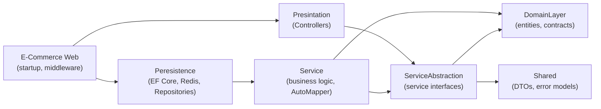
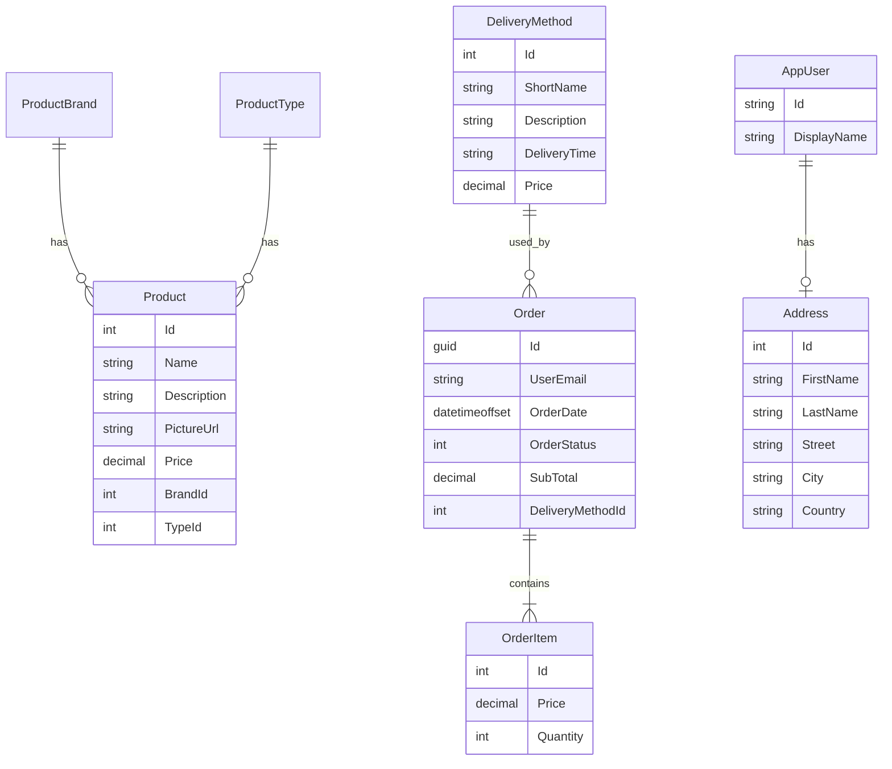

# Talabat Platform

A RESTful e-commerce backend built with **ASP.NET Core 8 Web API**, following **Onion Architecture**. It provides JWT authentication with ASP.NET Core Identity, a filterable and sortable product catalog, a Redis-backed shopping basket, and an order workflow with delivery methods.


## Table of Contents

- [Features](#features)
- [Architecture](#architecture)
- [Tech Stack](#tech-stack)
- [Project Structure](#project-structure)
- [Data Model](#data-model)
- [API Reference](#api-reference)
- [Error Handling](#error-handling)
- [Getting Started](#getting-started)
- [Roadmap](#roadmap)
- [Author](#author)

## Features

**Authentication and users**
- Register and login with ASP.NET Core Identity; JWT bearer tokens (HMAC SHA-256, 1-hour lifetime) carrying user id, name, email, and role claims.
- Email availability check, current-user endpoint, and per-user address management.
- Role-based authorization with seeded `Admin` and `SuperAdmin` roles.

**Product catalog**
- Product list with filtering by type and brand, case-insensitive name search, and sorting by name or price (ascending or descending).
- Product details, brands, and types endpoints.
- Product images served as static files, with full picture URLs built through an AutoMapper value resolver.

**Shopping basket**
- Basket stored in **Redis** as JSON, keyed by basket id, with a 30-day expiry.
- Create or update, get, and delete operations; works for guest users (no login required).

**Orders**
- Create an order from a basket: product prices are always re-read from the database, never trusted from the client.
- Delivery methods, order history per user (newest first), and order lookup by id.
- Order total = items subtotal + delivery method price; orders start with `Pending` status.

**Engineering practices**
- Onion Architecture with a strict dependency direction (the core never depends on infrastructure).
- Generic Repository, Unit of Work, and **Specification pattern** for composable queries (criteria, includes, ordering).
- Service Manager that creates services lazily.
- AutoMapper profiles and custom value resolvers; DTOs for every request and response.
- Global exception-handling middleware with a consistent JSON error contract, plus a custom response for validation errors and unknown endpoints.
- EF Core migrations with two DbContexts (store and identity) and automatic migration and data seeding on startup.
- Swagger / OpenAPI documentation.

## Architecture



Request flow: `Controller -> IServiceManager -> Service -> IUnitOfWork / IBasketReposatory -> Repository -> SQL Server / Redis`, then AutoMapper maps entities to DTOs on the way back. Contracts (`IGinaricRepository`, `IUnitOfWork`, `ISpecification`, `IBasketReposatory`) live in `DomainLayer`, and their implementations live in `Peresistence`.

## Tech Stack

| Area | Technology |
|---|---|
| Framework | .NET 8, ASP.NET Core Web API |
| ORM | Entity Framework Core 8 (SQL Server provider, migrations) |
| Database | SQL Server |
| Cache / basket store | Redis (StackExchange.Redis) |
| Authentication | ASP.NET Core Identity, JWT Bearer |
| Mapping | AutoMapper |
| API docs | Swagger (Swashbuckle) |
| Patterns | Onion Architecture, Repository, Unit of Work, Specification, Service Manager |

## Project Structure

```text
E-Commerce-Platform-Soluotion.slnx
├── Core
│   ├── DomainLayer          # Entities, contracts, domain exceptions
│   ├── ServiceAbstraction   # Service interfaces
│   └── Service              # Business logic, specifications, AutoMapper profiles
├── Infrastracture
│   ├── Peresistence         # DbContexts, repositories, Unit of Work, migrations, seeding, Redis
│   └── Presintation         # API controllers
├── Shared                   # DTOs, error models, query parameters
└── E-Commerce Web           # Startup project: Program, middleware, config, static images
```

## Data Model



- The **store database** (`talabat_DB`) holds products, brands, types, delivery methods, orders, and order items. The shipping address of an order and the product snapshot of an order item are stored as EF Core owned types.
- The **identity database** (`talabat_DB.Identity`) holds users, roles, and addresses.
- Baskets live only in **Redis**.

## API Reference

Base URL (development): `https://localhost:7118`. Protected endpoints require the header `Authorization: Bearer <token>`.

### Authentication

| Method | Endpoint | Access | Description |
|---|---|---|---|
| POST | `/api/Authentication/Login` | Public | Log in and receive a JWT |
| POST | `/api/Authentication/Register` | Public | Create an account and receive a JWT |
| GET | `/api/Authentication/CheckEmail?email=` | Public | Check whether an email is registered |
| GET | `/api/Authentication/CurrentUser` | Bearer | Get the current user |
| GET | `/api/Authentication/CurrentUserAddress` | Bearer | Get the current user's address |
| PUT | `/api/Authentication/Address` | Bearer | Create or update the current user's address |

### Products

| Method | Endpoint | Access | Description |
|---|---|---|---|
| GET | `/api/Products` | Admin role | List products. Query: `TypeId`, `BrandId`, `SearchValue`, `SortingOptions` |
| GET | `/api/Products/{id}` | Admin role | Get a product by id |
| GET | `/api/Products/brands` | Admin role | List brands |
| GET | `/api/Products/types` | Admin role | List product types |

`SortingOptions`: `1` name ascending, `2` name descending, `3` price ascending, `4` price descending.

### Basket

| Method | Endpoint | Access | Description |
|---|---|---|---|
| POST | `/api/Basket` | Public | Create or update a basket |
| GET | `/api/Basket?id=` | Public | Get a basket |
| DELETE | `/api/Basket/{key}` | Public | Delete a basket |

### Orders

| Method | Endpoint | Access | Description |
|---|---|---|---|
| POST | `/api/Orders` | Bearer | Create an order from a basket |
| GET | `/api/Orders` | Bearer | List the current user's orders |
| GET | `/api/Orders/{id}` | Bearer | Get an order by id (GUID) |
| GET | `/api/Orders/DeliveryMethods` | Bearer | List delivery methods |

<details>
<summary>Example request bodies</summary>

**Register**
```json
{
  "email": "user@example.com",
  "password": "YourPassword123!",
  "userName": "user",
  "displayName": "Sample User",
  "phoneNumber": "01000000000"
}
```

**Create or update basket**
```json
{
  "id": "basket1",
  "items": [
    { "id": 1, "productName": "Italian Chicken Marinade", "pictureUrl": "", "price": 200, "quantity": 2 }
  ]
}
```

**Create order**
```json
{
  "basketId": "basket1",
  "deliveryMethodId": 1,
  "addressDTO": {
    "firstName": "Sample", "lastName": "User",
    "street": "1 Example St", "city": "Cairo", "country": "Egypt"
  }
}
```
</details>

## Error Handling

Every error returns JSON with the matching HTTP status code.

| Case | Status |
|---|---|
| Resource not found (product, order, user, address) | 404 |
| Wrong password | 401 |
| Validation or Identity errors | 400 |
| Unknown endpoint | 404 with the requested path |
| Unhandled exception | 500 |

```json
{ "statusCode": 404, "errorMassage": "Product With id = 99 is not found", "errors": null }
```

Model-validation failures return the list of invalid fields:

```json
{
  "statusCode": 400,
  "errorMassage": "Validation Error",
  "validationErrors": [ { "field": "Email", "errorList": ["The Email field is not a valid e-mail address."] } ]
}
```

## Getting Started

### Prerequisites

- [.NET 8 SDK](https://dotnet.microsoft.com/download/dotnet/8.0)
- SQL Server (the default connection strings use a local instance with Windows authentication)
- Redis, for example with Docker:
  ```bash
  docker run -d --name redis -p 6379:6379 redis
  ```

### Run the project

```bash
git clone https://github.com/AnasEltohamy/Talabat-Platform.git
cd Talabat-Platform
```

1. Open `E-Commerce Web/appsettings.json` and review the settings:

   | Key | Purpose |
   |---|---|
   | `ConnectionStrings:StoreConnection` | Store database (`talabat_DB`) |
   | `ConnectionStrings:IdentityStoreConnection` | Identity database (`talabat_DB.Identity`) |
   | `ConnectionStrings:RedisConnection` | Redis host (default `localhost`) |
   | `URLs:baseUrl` | Base URL used to build product picture URLs |
   | `JWTOptions:SecretKey` | Signing key. Replace the placeholder with your own long random secret and never commit it |

2. Start the API from the web project folder (the seed files are read with a relative path):

   ```bash
   cd "E-Commerce Web"
   dotnet run --launch-profile https
   ```

3. On startup the app applies the EF Core migrations to both databases and seeds the data automatically: 6 brands, 4 types, 18 products, 4 delivery methods, the `Admin` and `SuperAdmin` roles, and two demo users (see `DataSeeding.cs`; development use only).

4. Open Swagger at `https://localhost:7118/swagger`.

> Swagger UI does not yet have an Authorize button, so test the protected endpoints with Postman or curl using the `Authorization: Bearer <token>` header. Product endpoints require a user in the `Admin` role.

## Roadmap

- [ ] Stripe payment integration and payment-based order statuses (in progress)
- [ ] Caching (in progress)
- [ ] Angular client integration (in progress)
- [ ] Swagger documentation improvements, including JWT authorization

## Author

**Anas Adel Eltohamy** — .NET Developer, Cairo, Egypt
- Portfolio: [MyPortfolio](https://portfolio.anas-website.workers.dev/)
- LinkedIn: [anasadeleltohamy](https://www.linkedin.com/in/anasadeleltohamy/)
- GitHub: [AnasEltohamy](https://github.com/AnasEltohamy)


