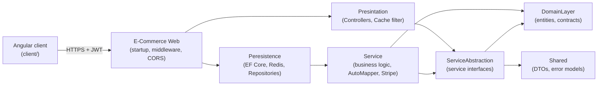
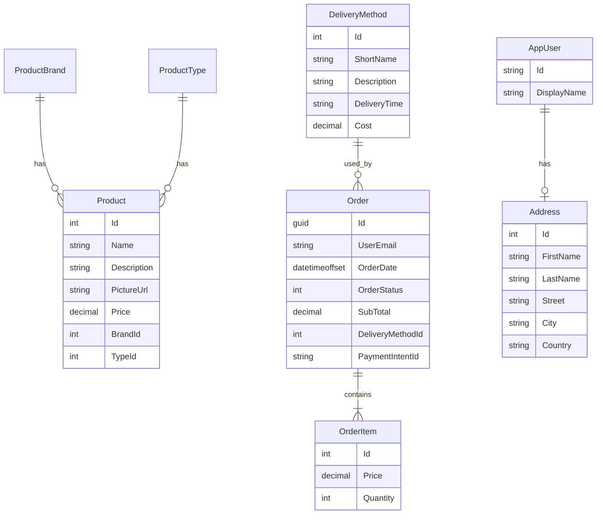

# Talabat Platform

An e-commerce platform whose core is a **RESTful backend built with ASP.NET Core 8 Web API** using Onion Architecture. It provides JWT authentication with ASP.NET Core Identity, a paginated, filterable and sortable product catalog, a Redis-backed basket with response caching, an order workflow with delivery methods, and Stripe payment intents. The API is integrated with an Angular storefront client (the `client/` folder).


> **Status legend:** ✅ implemented · 🚧 in progress

## Table of Contents

- [Features](#features)
- [Project Status](#project-status)
- [Architecture](#architecture)
- [Tech Stack](#tech-stack)
- [Project Structure](#project-structure)
- [Data Model](#data-model)
- [API Reference](#api-reference)
- [Payment Flow](#payment-flow)
- [Error Handling](#error-handling)
- [Getting Started](#getting-started)
- [Roadmap](#roadmap)
- [Author](#author)

## Features

**Authentication and users** ✅
- Register and login with ASP.NET Core Identity; JWT bearer tokens (HMAC SHA-256, 1-hour lifetime) carrying user id, name, email, and role claims.
- Email availability check, current-user endpoint, and per-user address management.
- `Admin` and `SuperAdmin` roles are seeded, ready for role-based authorization of future admin features.

**Product catalog** ✅
- Filtering by type and brand, case-insensitive name search, sorting (name, price ascending, price descending), and pagination with a total count that respects the filters.
- Product details, brands, and types endpoints.
- Product images served as static files, with full picture URLs built through an AutoMapper value resolver.

**Caching** ✅
- Redis response caching through a custom `[Cache(seconds)]` action filter, applied to the product list and product details (60 seconds). The cache key is the request path plus the sorted query parameters, and the authorization check runs before the cache is read.

**Shopping basket** ✅
- Basket stored in **Redis** as JSON with a 30-day expiry; works for guests (no login required).
- Create or update, get (an unknown id returns an empty basket), and delete.

**Orders** ✅
- An order is created from a basket; product prices are always re-read from the database, never trusted from the client.
- Delivery methods, order history per user (newest first), and order lookup by id.
- Order total = items subtotal + delivery cost.

**Payments (Stripe)** ✅ payment intents · 🚧 payment confirmation
- A Stripe PaymentIntent is created or updated from the basket, with the amount computed on the server (database prices plus the delivery cost) in USD.
- The `PaymentIntentId` is stored on the order.
- Updating the order status after the payment is confirmed (webhook) is in progress, see [Project Status](#project-status).

**Angular client integration** ✅
- The API is consumed by an Angular storefront in `client/`: shop with search, sorting and paging, basket, account, checkout with delivery methods and Stripe card payment, and order history. CORS is configured for the Angular development origin.

**Engineering practices** ✅
- Onion Architecture with a strict dependency direction (the core never depends on infrastructure).
- Generic Repository, Unit of Work, and **Specification pattern** (criteria, includes, ordering, pagination, count).
- Service Manager that creates services lazily; AutoMapper profiles and custom value resolvers; DTOs for every request and response.
- Global exception-handling middleware with a consistent JSON error contract, plus custom responses for validation errors and unknown endpoints.
- EF Core migrations with two DbContexts (store and identity), and automatic migration and data seeding on startup.
- Swagger / OpenAPI documentation.

## Project Status

| Area | Status |
|---|---|
| Authentication, accounts, JWT | ✅ |
| Product catalog (filter, search, sort, pagination) | ✅ |
| Redis basket and response caching | ✅ |
| Orders and delivery methods | ✅ |
| Stripe payment intent creation | ✅ |
| Stripe webhook: order status after payment (`Pending` → `PaymentReceived` / `PaymentFailed`) | 🚧 |
| Angular client connected to the API | ✅ |
| Deployment (API and client) | 🚧 |
| Swagger JWT authorization button | 🚧 |
| Postman collection | 🚧 |

> The `OrderStatus` values `PaymentReceived` and `PaymentFailed` already exist. Until the webhook is implemented, orders stay in `Pending`.

## Architecture



Request flow: `Controller -> IServiceManager -> Service -> IUnitOfWork / IBasketReposatory / ICacheRepository -> Repository -> SQL Server / Redis`, then AutoMapper maps entities to DTOs on the way back. Contracts (`IGinaricRepository`, `IUnitOfWork`, `ISpecification`, `IBasketReposatory`, `ICacheRepository`) live in `DomainLayer`, and their implementations live in `Peresistence`.

## Tech Stack

| Area | Technology |
|---|---|
| Framework | .NET 8, ASP.NET Core Web API |
| ORM | Entity Framework Core 8 (SQL Server provider, migrations) |
| Database | SQL Server |
| Basket store / response cache | Redis (StackExchange.Redis) |
| Authentication | ASP.NET Core Identity, JWT Bearer |
| Payments | Stripe (`Stripe.net`, payment intents) |
| Mapping | AutoMapper |
| API docs | Swagger (Swashbuckle) |
| Client | Angular 11 storefront (`client/`) |
| Patterns | Onion Architecture, Repository, Unit of Work, Specification, Service Manager |

## Project Structure

```text
E-Commerce-Platform-Soluotion.slnx
├── Core
│   ├── DomainLayer          # Entities, contracts, domain exceptions
│   ├── ServiceAbstraction   # Service interfaces
│   └── Service              # Business logic, specifications, AutoMapper profiles, payments
├── Infrastracture
│   ├── Peresistence         # DbContexts, repositories, Unit of Work, migrations, seeding, Redis
│   └── Presintation         # API controllers, cache filter
├── Shared                   # DTOs, error models, query parameters
├── E-Commerce Web           # Startup project: Program, middleware, config, static images
└── client                   # Angular storefront
```

## Data Model



- The **store database** (`talabat_DB`) holds products, brands, types, delivery methods, orders, and order items. The shipping address of an order and the product snapshot of an order item are stored as EF Core owned types.
- The **identity database** (`talabat_DB.Identity`) holds users, roles, and addresses.
- **Redis** holds baskets (including the payment intent data) and the cached product responses.

## API Reference

Base URL (development): `https://localhost:5001`. Protected endpoints require the header `Authorization: Bearer <token>`. 18 endpoints.

### Authentication

| Method | Endpoint | Access | Description |
|---|---|---|---|
| POST | `/api/Authentication/Login` | Public | Log in and receive a JWT |
| POST | `/api/Authentication/Register` | Public | Create an account and receive a JWT |
| GET | `/api/Authentication/emailexists?email=` | Public | Check whether an email is registered |
| GET | `/api/Authentication` | Bearer | Get the current user |
| GET | `/api/Authentication/address` | Bearer | Get the current user's address (204 if none) |
| PUT | `/api/Authentication/Address` | Bearer | Create or update the current user's address |

### Products

| Method | Endpoint | Access | Description |
|---|---|---|---|
| GET | `/api/Products` | Public | List products (paginated, cached for 60 seconds) |
| GET | `/api/Products/{id}` | Public | Get a product by id (cached for 60 seconds) |
| GET | `/api/Products/brands` | Public | List brands |
| GET | `/api/Products/types` | Public | List product types |

Query parameters of `GET /api/Products`:

| Parameter | Description |
|---|---|
| `TypeId`, `BrandId` | Filter by type or brand |
| `search` | Case-insensitive name search |
| `sort` | `name` (or `nameAsc`), `priceAsc`, `priceDesc` |
| `PageIndex` | Page number, default `1` (values below 1 become 1) |
| `PageSize` | Page size, default `5`, maximum `10` |

Response:

```json
{
  "pageIndex": 1,
  "pageSize": 5,
  "totalCount": 18,
  "data": [
    { "id": 1, "name": "...", "description": "...", "pictureUrl": "https://localhost:5001/images/products/...", "price": 0, "brand": "...", "type": "..." }
  ]
}
```

`totalCount` is the number of products matching the filters, and `pageSize` is the number of items returned on that page.

### Baskets

| Method | Endpoint | Access | Description |
|---|---|---|---|
| POST | `/api/baskets` | Public | Create or update a basket |
| GET | `/api/baskets?id=` | Public | Get a basket (an unknown id returns an empty basket) |
| DELETE | `/api/baskets?id=` | Public | Delete a basket |

### Orders

| Method | Endpoint | Access | Description |
|---|---|---|---|
| POST | `/api/Orders` | Bearer | Create an order from a basket |
| GET | `/api/Orders` | Bearer | List the current user's orders |
| GET | `/api/Orders/{id}` | Bearer | Get an order by id (GUID) |
| GET | `/api/Orders/deliveryMethods` | Bearer | List delivery methods |

### Payments

| Method | Endpoint | Access | Description |
|---|---|---|---|
| POST | `/api/payments/{basketId}` | Bearer | Create or update the Stripe PaymentIntent for a basket |

<details>
<summary>Example request bodies</summary>

**Register**
```json
{
  "email": "user@example.com",
  "password": "YourPassword123!",
  "displayName": "Sample User"
}
```

**Create or update basket**
```json
{
  "id": "basket1",
  "items": [
    { "id": 1, "productName": "Italian Chicken Marinade", "pictureUrl": "", "price": 200, "quantity": 2 }
  ],
  "deliveryMethodId": 1
}
```

**Create order**
```json
{
  "basketId": "basket1",
  "deliveryMethodId": 1,
  "shipToAddress": {
    "firstName": "Sample", "lastName": "User",
    "street": "1 Example St", "city": "Cairo", "country": "Egypt"
  }
}
```
</details>

## Payment Flow

1. The client saves the basket with the chosen delivery method (`POST /api/baskets`).
2. The client asks the API for a payment intent (`POST /api/payments/{basketId}`). The API recomputes the total from database prices plus the delivery cost, creates or updates the Stripe PaymentIntent, and returns the basket with the `clientSecret` and `paymentIntentId`.
3. The client creates the order (`POST /api/Orders`); the `PaymentIntentId` is stored on the order.
4. The client confirms the card payment with Stripe.js using the `clientSecret`.
5. 🚧 Stripe notifies the API through a webhook, and the order status moves from `Pending` to `PaymentReceived` or `PaymentFailed`.

Use Stripe **test mode** keys and test cards (for example `4242 4242 4242 4242`). The secret key stays on the server; only the publishable key is used in the client.

## Error Handling

Every error returns JSON with the matching HTTP status code.

| Case | Status |
|---|---|
| Resource not found (product, order, delivery method, unknown endpoint) | 404 |
| Wrong credentials, or a missing or invalid token | 401 |
| Validation or Identity errors | 400 |
| Unhandled exception | 500 |

```json
{ "statusCode": 404, "message": "Product With id = 99 is not found", "errors": null }
```

Identity errors (for example a weak password) return the list in `errors`. Model-validation failures return the invalid fields:

```json
{
  "statusCode": 400,
  "message": "Validation Error",
  "validationErrors": [ { "field": "Email", "errorList": ["The Email field is not a valid e-mail address."] } ]
}
```

## Getting Started

### Prerequisites

- [.NET 8 SDK](https://dotnet.microsoft.com/download/dotnet/8.0)
- SQL Server (the default connection strings use a local instance with Windows authentication)
- Redis, for example with Docker:
  ```bash
  docker run -d --name redis -p 6379:6379 redis
  ```
- Node.js 14 for the Angular client (Angular 11). With newer Node versions, run `npm start` with `NODE_OPTIONS=--openssl-legacy-provider`.
- A trusted HTTPS development certificate: `dotnet dev-certs https --trust`
- A Stripe account in test mode, to try the payment step

### Run the API

```bash
git clone https://github.com/AnasEltohamy/Talabat-Platform.git
cd Talabat-Platform
```

1. Review `E-Commerce Web/appsettings.json`:

   | Key | Purpose |
   |---|---|
   | `ConnectionStrings:StoreConnection` | Store database (`talabat_DB`) |
   | `ConnectionStrings:IdentityStoreConnection` | Identity database (`talabat_DB.Identity`) |
   | `ConnectionStrings:RedisConnection` | Redis host (default `localhost`) |
   | `URLs:baseUrl` | Base URL used to build product picture URLs |
   | `JWTOptions:SecretKey` | Signing key: replace the placeholder with your own long random secret and never commit it |
   | `StripeSettings:SecretKey` | Stripe secret key (kept empty in the repository) |

2. Store the Stripe secret key with .NET User Secrets, so it never reaches the repository:

   ```bash
   dotnet user-secrets init --project "E-Commerce Web"
   dotnet user-secrets set "StripeSettings:SecretKey" "sk_test_xxxxxxxx" --project "E-Commerce Web"
   ```

3. Start the API from the web project folder (the seed files are read with a relative path):

   ```bash
   cd "E-Commerce Web"
   dotnet run --launch-profile https
   ```

4. On startup the app applies the EF Core migrations to both databases and seeds the data: 6 brands, 4 types, 18 products, 4 delivery methods, the `Admin` and `SuperAdmin` roles, and two demo users (see `DataSeeding.cs`; development use only).

5. Open Swagger at `https://localhost:5001/swagger`.

> Swagger UI does not have an Authorize button yet, so test the protected endpoints with Postman, curl, or the Angular client, using the `Authorization: Bearer <token>` header.

### Run the Angular client

```bash
cd client
npm install
npm start
```

Open `http://localhost:4200`. The client expects the API at `https://localhost:5001/api/` (`client/src/environments/environment.ts`). To try the card payment, put your own Stripe **publishable** key in `client/src/app/checkout/checkout-payment/checkout-payment.component.ts`.

> The Angular storefront is a ready-made client that is connected to this API. The focus of this repository is the backend.

## Roadmap

- [ ] Stripe webhook to update the order status after payment (in progress)
- [ ] Deployment of the API and the client (in progress)
- [ ] Swagger documentation improvements, including JWT authorization
- [ ] Postman collection for the API

## Author

**Anas Adel Eltohamy** — .NET Developer, Cairo, Egypt

- Portfolio: [MyPortfolio](https://portfolio.anas-website.workers.dev/)
- LinkedIn: [anasadeleltohamy](https://www.linkedin.com/in/anasadeleltohamy/)
- GitHub: [AnasEltohamy](https://github.com/AnasEltohamy)
