# Talabat Platform

An e-commerce platform whose core is a **RESTful backend built with ASP.NET Core 8 Web API** using Onion Architecture. It provides JWT authentication with ASP.NET Core Identity, a paginated, filterable and sortable product catalog, a Redis-backed basket with response caching, an order workflow with delivery methods, and Stripe payments with webhook-driven order status. The API is consumed by a responsive **Angular 11 storefront** (the `client/` folder).

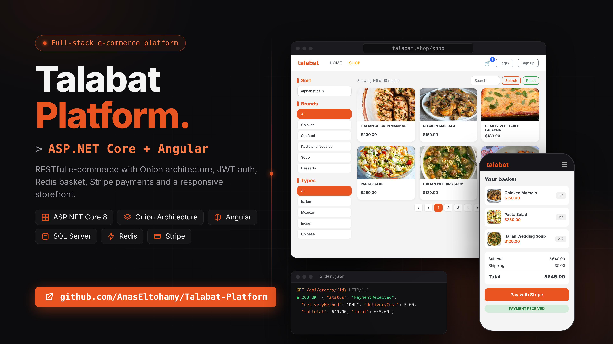


## Table of Contents

- [Screenshots](#screenshots)
- [Features](#features)
- [Architecture](#architecture)
- [Tech Stack](#tech-stack)
- [Project Structure](#project-structure)
- [Data Model](#data-model)
- [API Reference](#api-reference)
- [Payment Flow](#payment-flow)
- [Error Handling](#error-handling)
- [Run it locally](#run-it-locally)
- [Try the full flow](#try-the-full-flow)
- [Troubleshooting](#troubleshooting)
- [Security notes](#security-notes)
- [Author](#author)

## Screenshots

| Home | Shop |
|---|---|
| 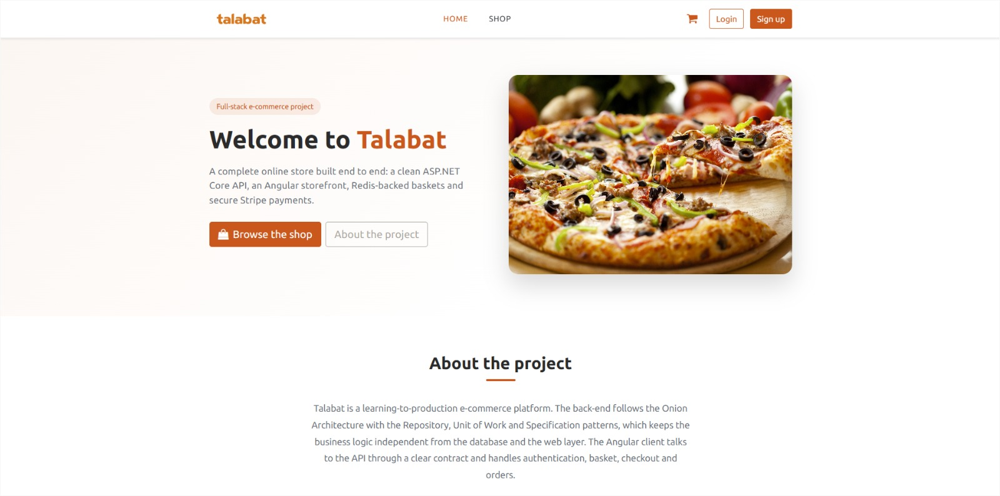 | 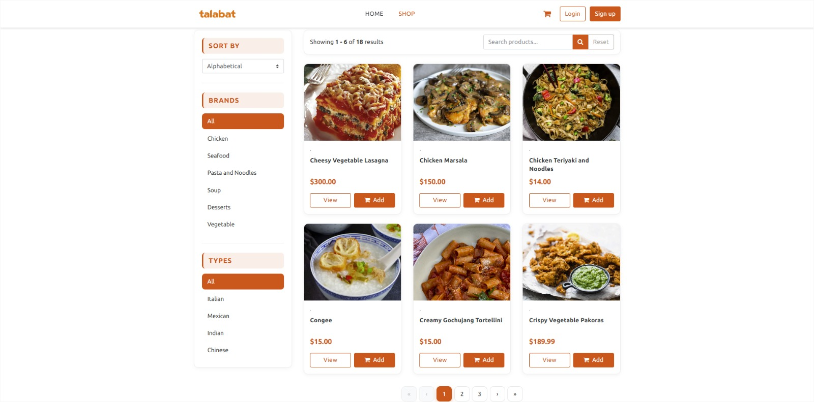 |

| Product details | Basket |
|---|---|
| 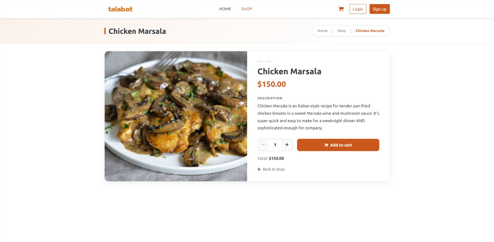 | 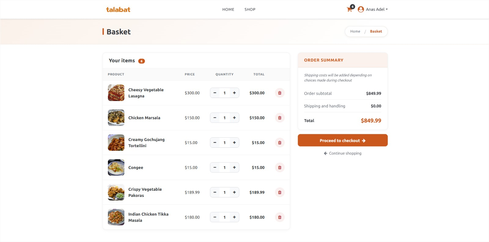 |

| Checkout (address, delivery, review, payment) | Order details |
|---|---|
| 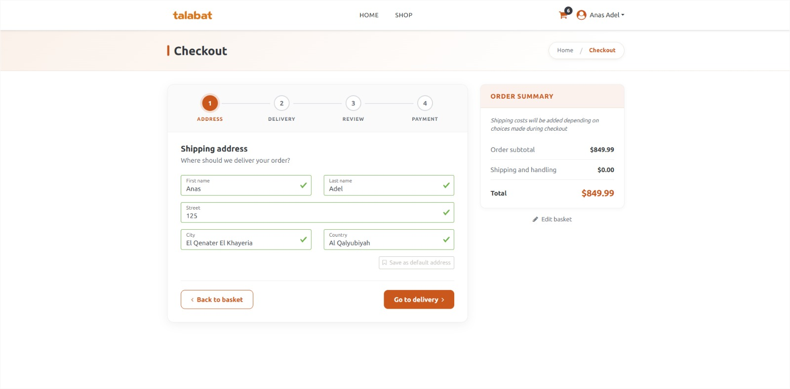 | 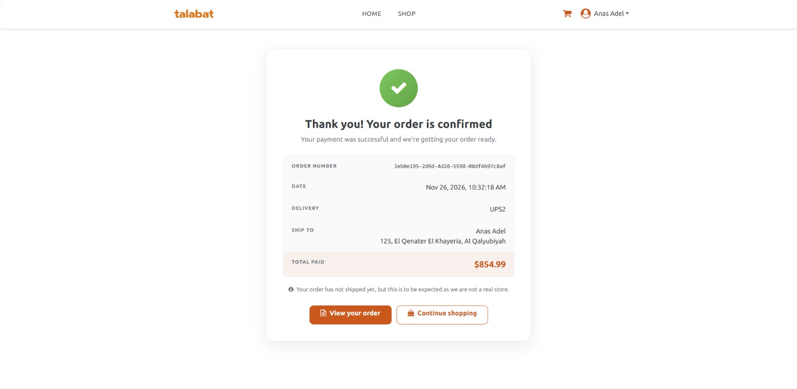 |

| Swagger UI |
|---|
| 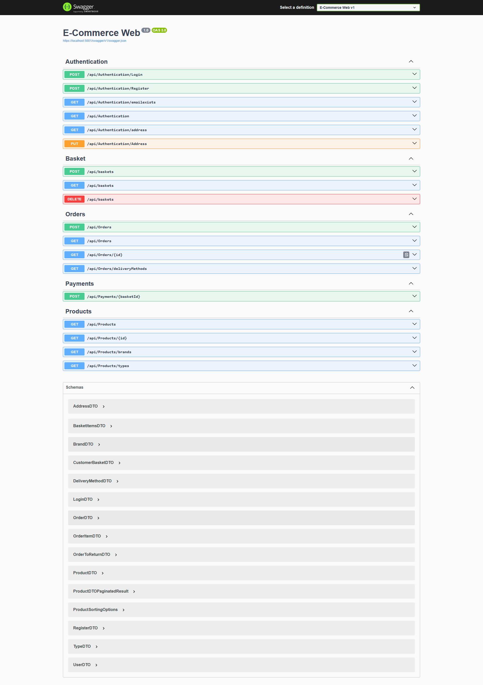 |

## Features

**Authentication and users**
- Register and login with ASP.NET Core Identity; JWT bearer tokens (HMAC SHA-256, 1-hour lifetime) carrying user id, name, email, and role claims.
- Email availability check, current-user endpoint, and per-user address management.
- `Admin` and `SuperAdmin` roles are seeded, ready for role-based authorization of future admin features.

**Product catalog**
- Filtering by type and brand, case-insensitive name search, sorting (name, price ascending, price descending), and pagination with a total count that respects the filters.
- Product details, brands, and types endpoints.
- Product images served as static files, with full picture URLs built through an AutoMapper value resolver.

**Caching**
- Redis response caching through a custom `[Cache(seconds)]` action filter, applied to the product list and product details (60 seconds). The cache key is the request path plus the sorted query parameters, and the authorization check runs before the cache is read.

**Shopping basket**
- Basket stored in **Redis** as JSON with a 30-day expiry; works for guests (no login required).
- Create or update, get (an unknown id returns an empty basket), and delete.

**Orders**
- An order is created from a basket; product prices are always re-read from the database, never trusted from the client.
- Delivery methods, order history per user (newest first), and order lookup by id.
- Order total = items subtotal + delivery cost.
- Order status: `Pending` -> `PaymentReceived` or `PaymentFailed`.

**Payments (Stripe)**
- A Stripe PaymentIntent is created or updated from the basket, with the amount computed on the server (database prices plus the delivery cost) in USD.
- The `PaymentIntentId` is stored on the order.
- A **Stripe webhook** endpoint verifies the event signature and moves the order status from `Pending` to `PaymentReceived` (`payment_intent.succeeded`) or `PaymentFailed` (`payment_intent.payment_failed`).

**Angular storefront (`client/`)**
- Home, shop (search, sorting, brand and type filters, paging), product details, basket, login and register.
- A four-step checkout: address, delivery method, review, and Stripe card payment, followed by a confirmation page.
- Order history and order details with a payment status badge.
- Custom not-found and server-error pages. Built with Bootstrap 4 (Bootswatch United), ngx-bootstrap, and xng-breadcrumb.

**Engineering practices**
- Onion Architecture with a strict dependency direction (the core never depends on infrastructure).
- Generic Repository, Unit of Work, and **Specification pattern** (criteria, includes, ordering, pagination, count).
- Service Manager that creates services lazily; AutoMapper profiles and custom value resolvers; DTOs for every request and response.
- Global exception-handling middleware with a consistent JSON error contract, plus custom responses for validation errors and unknown endpoints.
- EF Core migrations with two DbContexts (store and identity), and automatic migration and data seeding on startup.
- Swagger / OpenAPI documentation.

## Architecture

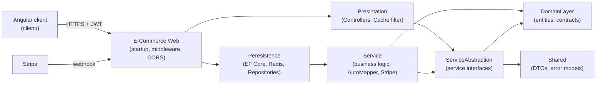

Request flow: `Controller -> IServiceManager -> Service -> IUnitOfWork / IBasketReposatory / ICacheRepository -> Repository -> SQL Server / Redis`, then AutoMapper maps entities to DTOs on the way back. Contracts (`IGinaricRepository`, `IUnitOfWork`, `ISpecification`, `IBasketReposatory`, `ICacheRepository`) live in `DomainLayer`, and their implementations live in `Peresistence`.

## Tech Stack

| Area | Technology |
|---|---|
| Framework | .NET 8, ASP.NET Core Web API |
| ORM | Entity Framework Core 8 (SQL Server provider, migrations) |
| Database | SQL Server |
| Basket store / response cache | Redis (StackExchange.Redis) |
| Authentication | ASP.NET Core Identity, JWT Bearer |
| Payments | Stripe (`Stripe.net`, payment intents, webhooks) |
| Mapping | AutoMapper |
| API docs | Swagger (Swashbuckle) |
| Client | Angular 11, Bootstrap 4 (Bootswatch United), ngx-bootstrap, ngx-toastr, xng-breadcrumb |
| Patterns | Onion Architecture, Repository, Unit of Work, Specification, Service Manager |

## Project Structure

```text
E-Commerce-Platform-Soluotion.slnx
├── Core
│   ├── DomainLayer          # Entities, contracts, domain exceptions
│   ├── ServiceAbstraction   # Service interfaces
│   └── Service              # Business logic, specifications, AutoMapper profiles, payments
├── Infrastracture
│   ├── Peresistence         # DbContexts, repositories, Unit of Work, migrations, seeding, Redis
│   └── Presintation         # API controllers, cache filter
├── Shared                   # DTOs, error models, query parameters
├── E-Commerce Web           # Startup project: Program, middleware, config, static images
├── client                   # Angular storefront
└── docs/images              # README images
```

## Data Model

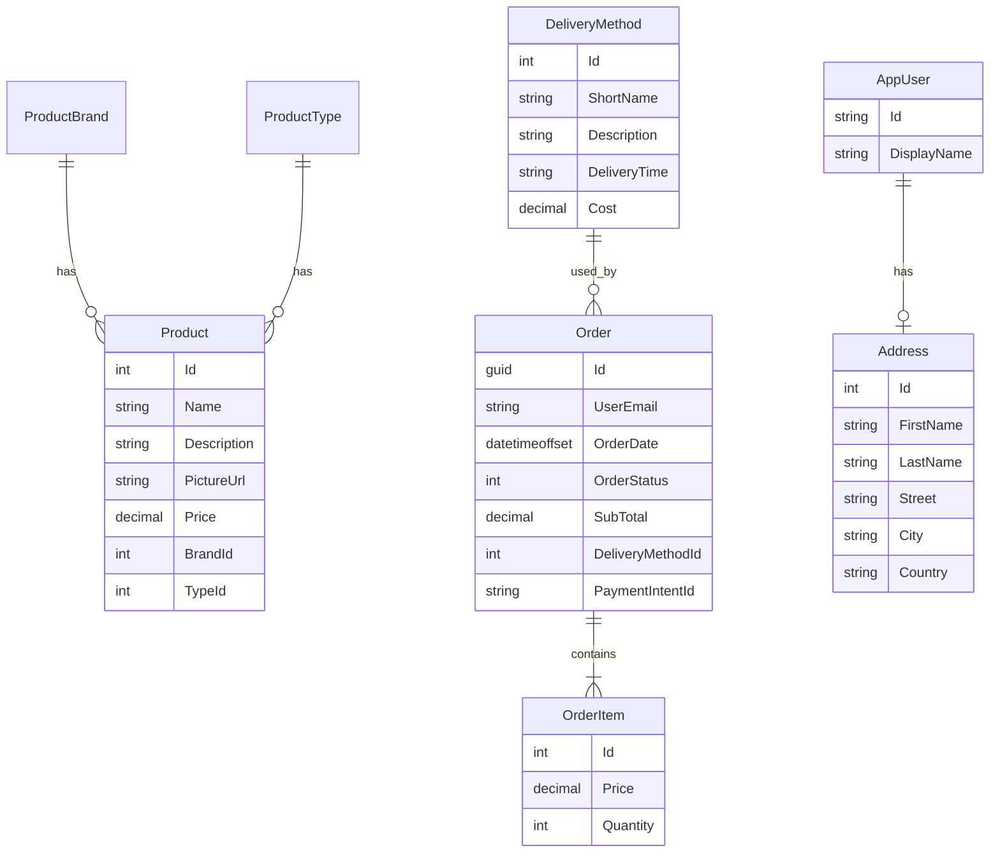

- The **store database** (`talabat_DB`) holds products, brands, types, delivery methods, orders, and order items. The shipping address of an order and the product snapshot of an order item are stored as EF Core owned types.
- The **identity database** (`talabat_DB.Identity`) holds users, roles, and addresses.
- **Redis** holds baskets (including the payment intent data) and the cached product responses.

## API Reference

Base URL (development): `https://localhost:5001`. Protected endpoints require the header `Authorization: Bearer <token>`. 19 endpoints.

### Authentication

| Method | Endpoint | Access | Description |
|---|---|---|---|
| POST | `/api/Authentication/Login` | Public | Log in and receive a JWT |
| POST | `/api/Authentication/Register` | Public | Create an account and receive a JWT |
| GET | `/api/Authentication/emailexists?email=` | Public | Check whether an email is registered |
| GET | `/api/Authentication` | Bearer | Get the current user |
| GET | `/api/Authentication/address` | Bearer | Get the current user's address (204 if none) |
| PUT | `/api/Authentication/Address` | Bearer | Create or update the current user's address |

### Products

| Method | Endpoint | Access | Description |
|---|---|---|---|
| GET | `/api/Products` | Public | List products (paginated, cached for 60 seconds) |
| GET | `/api/Products/{id}` | Public | Get a product by id (cached for 60 seconds) |
| GET | `/api/Products/brands` | Public | List brands |
| GET | `/api/Products/types` | Public | List product types |

Query parameters of `GET /api/Products`:

| Parameter | Description |
|---|---|
| `TypeId`, `BrandId` | Filter by type or brand |
| `search` | Case-insensitive name search |
| `sort` | `name` (or `nameAsc`), `priceAsc`, `priceDesc` |
| `PageIndex` | Page number, default `1` (values below 1 become 1) |
| `PageSize` | Page size, default `5`, maximum `10` |

Response:

```json
{
  "pageIndex": 1,
  "pageSize": 5,
  "totalCount": 18,
  "data": [
    { "id": 1, "name": "...", "description": "...", "pictureUrl": "https://localhost:5001/images/products/...", "price": 0, "brand": "...", "type": "..." }
  ]
}
```

`totalCount` is the number of products matching the filters, and `pageSize` is the number of items returned on that page.

### Baskets

| Method | Endpoint | Access | Description |
|---|---|---|---|
| POST | `/api/baskets` | Public | Create or update a basket |
| GET | `/api/baskets?id=` | Public | Get a basket (an unknown id returns an empty basket) |
| DELETE | `/api/baskets?id=` | Public | Delete a basket |

### Orders

| Method | Endpoint | Access | Description |
|---|---|---|---|
| POST | `/api/Orders` | Bearer | Create an order from a basket |
| GET | `/api/Orders` | Bearer | List the current user's orders |
| GET | `/api/Orders/{id}` | Bearer | Get an order by id (GUID) |
| GET | `/api/Orders/deliveryMethods` | Bearer | List delivery methods |

An order is returned with this shape:

```json
{
  "id": "cbcb59ac-...",
  "buyerEmail": "anas@gmail.com",
  "items": [ { "productId": 1, "productName": "...", "pictureUrl": "...", "price": 200, "quantity": 1 } ],
  "deliveryMethod": "DHL",
  "deliveryCost": 5,
  "subtotal": 200,
  "total": 205,
  "orderDate": "2026-11-26T10:00:00+00:00",
  "status": "PaymentReceived",
  "shipToAddress": { "firstName": "...", "lastName": "...", "street": "...", "city": "...", "country": "..." }
}
```

### Payments

| Method | Endpoint | Access | Description |
|---|---|---|---|
| POST | `/api/payments/{basketId}` | Bearer | Create or update the Stripe PaymentIntent for a basket |
| POST | `/api/payments/webhook` | Stripe signature | Receive Stripe events and update the order status |

<details>
<summary>Example request bodies</summary>

**Register**
```json
{
  "email": "user@example.com",
  "password": "YourPassword123!",
  "displayName": "Sample User"
}
```

**Create or update basket**
```json
{
  "id": "basket1",
  "items": [
    { "id": 1, "productName": "Italian Chicken Marinade", "pictureUrl": "", "price": 200, "quantity": 2 }
  ],
  "deliveryMethodId": 1
}
```

**Create order**
```json
{
  "basketId": "basket1",
  "deliveryMethodId": 1,
  "shipToAddress": {
    "firstName": "Sample", "lastName": "User",
    "street": "1 Example St", "city": "Cairo", "country": "Egypt"
  }
}
```
</details>

## Payment Flow

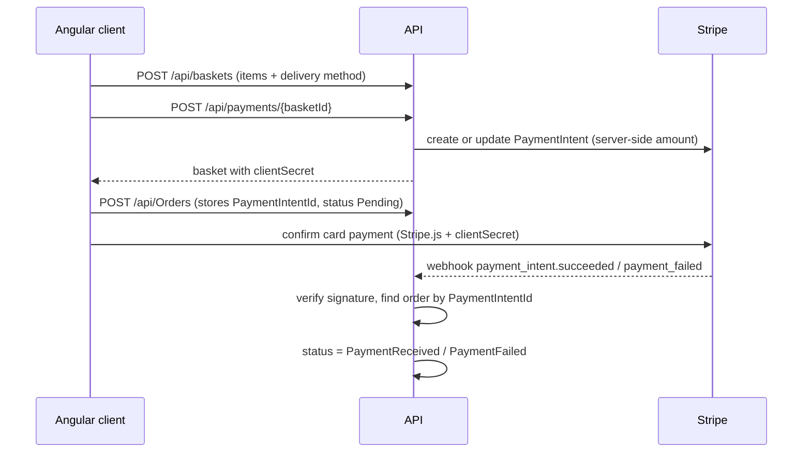

1. The client saves the basket with the chosen delivery method (`POST /api/baskets`).
2. The client asks the API for a payment intent (`POST /api/payments/{basketId}`). The API recomputes the total from database prices plus the delivery cost, creates or updates the Stripe PaymentIntent, and returns the basket with the `clientSecret` and `paymentIntentId`.
3. The client creates the order (`POST /api/Orders`); the `PaymentIntentId` is stored on the order and the status starts as `Pending`.
4. The client confirms the card payment with Stripe.js using the `clientSecret`.
5. Stripe notifies the API through a webhook (`POST /api/payments/webhook`). The API verifies the signature, finds the order by its `PaymentIntentId`, and moves its status from `Pending` to `PaymentReceived` or `PaymentFailed`.

Use Stripe **test mode** keys and test cards. The secret key and webhook secret stay on the server; only the publishable key is used in the client.

## Error Handling

Every error returns JSON with the matching HTTP status code.

| Case | Status |
|---|---|
| Resource not found (product, order, delivery method, unknown endpoint) | 404 |
| Wrong credentials, or a missing or invalid token | 401 |
| Validation or Identity errors | 400 |
| Unhandled exception | 500 |

```json
{ "statusCode": 404, "message": "Product With id = 99 is not found", "errors": null }
```

Identity errors (for example a weak password) return the list in `errors`. Model-validation failures return the invalid fields:

```json
{
  "statusCode": 400,
  "message": "Validation Error",
  "validationErrors": [ { "field": "Email", "errorList": ["The Email field is not a valid e-mail address."] } ]
}
```

## Run it locally

### 1. Prerequisites

| Tool | Version / notes |
|---|---|
| [.NET SDK](https://dotnet.microsoft.com/download) | 8.0 or newer. The solution file is `.slnx`, which needs the .NET 9 SDK (or Visual Studio 2022 17.13+). With the .NET 8 SDK, open or build the `E-Commerce Web/E-Commerce Web.csproj` project directly |
| SQL Server | Any edition (Express or LocalDB is fine) |
| Redis | Port `6379`. On Windows the easiest way is Docker: `docker run -d --name redis -p 6379:6379 redis` |
| Node.js + npm | Node **14** for Angular 11. With a newer Node, set `NODE_OPTIONS=--openssl-legacy-provider` before `npm start` |
| HTTPS dev certificate | `dotnet dev-certs https --trust` |
| Stripe account (test mode) | Needed for the payment step. A free account is enough |
| [Stripe CLI](https://docs.stripe.com/stripe-cli) | Forwards webhook events to your local API |

### 2. What you must change before running

Nothing secret is stored in this repository, so a fresh clone needs these values from you:

| # | Where | What to set | Required for |
|---|---|---|---|
| 1 | `E-Commerce Web/appsettings.json` -> `ConnectionStrings:StoreConnection` and `IdentityStoreConnection` | Your SQL Server instance. The default is `server=.` with Windows authentication. For SQL authentication use `server=YOUR_SERVER;Database=talabat_DB;User Id=...;Password=...;TrustServerCertificate=true` | Everything |
| 2 | `ConnectionStrings:RedisConnection` | Redis host, default `localhost` | Basket, product cache |
| 3 | `JWTOptions:SecretKey` (User Secrets) | A long random string, at least 32 characters | Login |
| 4 | `StripeSettings:SecretKey` (User Secrets) | Your `sk_test_...` key | Payment |
| 5 | `StripeSettings:WebhookSecret` (User Secrets) | The `whsec_...` printed by `stripe listen` | Order status update |
| 6 | `client/src/app/checkout/checkout-payment/checkout-payment.component.ts` | Your `pk_test_...` publishable key in `Stripe('pk_test_...')`. It must belong to the same Stripe account as the secret key | Payment |
| 7 | `URLs:baseUrl` and `JWTOptions:issuer` / `audience` | Only if you change the API URL or port (default `https://localhost:5001/`) | Product images, JWT |
| 8 | `client/src/environments/environment.ts` -> `apiUrl` | Only if you change the API URL | Client |

Get the Stripe keys from the [Stripe Dashboard](https://dashboard.stripe.com/test/apikeys) (test mode): the **Secret key** (`sk_test_...`) and the **Publishable key** (`pk_test_...`).

### 3. Run the API

```bash
git clone https://github.com/AnasEltohamy/Talabat-Platform.git
cd Talabat-Platform
```

Store the secrets with .NET User Secrets, so they never reach Git:

```bash
dotnet user-secrets init --project "E-Commerce Web"
dotnet user-secrets set "JWTOptions:SecretKey" "put-a-long-random-secret-of-at-least-32-characters" --project "E-Commerce Web"
dotnet user-secrets set "StripeSettings:SecretKey" "sk_test_xxxxxxxx" --project "E-Commerce Web"
```

> Alternatively, set environment variables instead: `JWTOptions__SecretKey`, `StripeSettings__SecretKey`, `StripeSettings__WebhookSecret` (a double underscore replaces `:`).

Start the API from the web project folder, because the seed files are read with a relative path:

```bash
cd "E-Commerce Web"
dotnet run --launch-profile https
```

On startup the app applies the EF Core migrations to both databases (they are created automatically) and seeds the data: 6 brands, 4 types, 18 products, 4 delivery methods, the `Admin` and `SuperAdmin` roles, and two demo users (development use only):

| Email | Password | Role |
|---|---|---|
| `anas@gmail.com` | `P@ssw0rd01` | Admin |
| `adel@gmail.com` | `P@ssw0rd02` | SuperAdmin |

Open Swagger at `https://localhost:5001/swagger`. Protected endpoints need a bearer token: call `POST /api/Authentication/Login`, then send the returned token in the `Authorization: Bearer <token>` header.

### 4. Start the Stripe webhook listener

Open a second terminal. The webhook updates the order status after payment; without it, orders stay `Pending`.

```bash
stripe login
stripe listen --events payment_intent.succeeded,payment_intent.payment_failed --forward-to https://localhost:5001/api/payments/webhook --skip-verify
```

Copy the `whsec_...` value it prints, store it, and restart the API:

```bash
dotnet user-secrets set "StripeSettings:WebhookSecret" "whsec_xxxxxxxx" --project "E-Commerce Web"
```

Keep `stripe listen` running while you test. The `whsec_...` stays the same each time you run `stripe listen` while logged in with the same account.

### 5. Run the Angular client

```bash
cd client
npm install
npm start
```

Open `http://localhost:4200`. The API allows CORS from `http://localhost:4200` and `https://localhost:4200`.

## Try the full flow

1. Open `http://localhost:4200/shop`, search, sort, and filter by brand or type.
2. Add a few dishes to the basket. Guests can have a basket without logging in.
3. Log in with a demo user (or register), then go to **Checkout**.
4. Fill in the address, pick a delivery method, review the order, and pay with a Stripe test card:

   | Card number | Result |
   |---|---|
   | `4242 4242 4242 4242` | Payment succeeds |
   | `4000 0000 0000 0002` | Card is declined |

   Use any future expiry date, any 3-digit CVC, and any postal code.
5. Open **View Orders** from the user menu. The new order shows `Pending` for a moment, then **Paid** once the webhook arrives. A declined card shows **Payment failed**.

## Troubleshooting

| Symptom | Likely cause and fix |
|---|---|
| `Cannot connect to SQL Server` or login failed | Change the connection strings in `appsettings.json` to your instance and authentication type |
| `It was not possible to connect to the redis server` | Redis is not running on `localhost:6379`. Start it, for example with the Docker command above |
| Login returns `500` | Read the exception text in the API console. A missing or very short `JWTOptions:SecretKey` is the usual cause; set a secret of at least 32 characters |
| Product images do not load | `URLs:baseUrl` does not match the address the API runs on |
| Browser shows a CORS or certificate error | Run `dotnet dev-certs https --trust`, then restart the API and the browser. Keep the client on port `4200` |
| `FileNotFoundException` for `brands.json` on startup | Run the API from inside the `E-Commerce Web` folder |
| The Stripe card form fails or shows an error | The publishable key in `checkout-payment.component.ts` is missing, or belongs to a different Stripe account than the secret key |
| Payment succeeds but the order stays `Pending` | `stripe listen` is not running, or `StripeSettings:WebhookSecret` is missing or outdated. Restart the API after setting it |
| `stripe` is not recognized on Windows | Open a new terminal after installing the Stripe CLI (it needs a refreshed `PATH`) |
| `npm start` fails with `ERR_OSSL_EVP_UNSUPPORTED` | Use Node 14, or set `NODE_OPTIONS=--openssl-legacy-provider` |
| `dotnet build` does not recognize the `.slnx` file | Use the .NET 9 SDK, or build `E-Commerce Web/E-Commerce Web.csproj` directly |

## Security notes

- Never commit `sk_test_...`, `whsec_...`, or the JWT secret. They belong in User Secrets or environment variables. If you pushed one by mistake, rotate it in the Stripe Dashboard.
- The demo users and the sample JWT placeholder in `appsettings.json` are for local development only.
- The Stripe publishable key is public by design, but each person who clones the repository should use the key of their own Stripe account.
- Product prices and the payment amount are always computed on the server from the database.

## Author

**Anas Adel Eltohamy** — .NET Developer, Cairo, Egypt

- Portfolio: [MyPortfolio](https://portfolio.anas-website.workers.dev/)
- LinkedIn: [anasadeleltohamy](https://www.linkedin.com/in/anasadeleltohamy/)
- GitHub: [AnasEltohamy](https://github.com/AnasEltohamy)